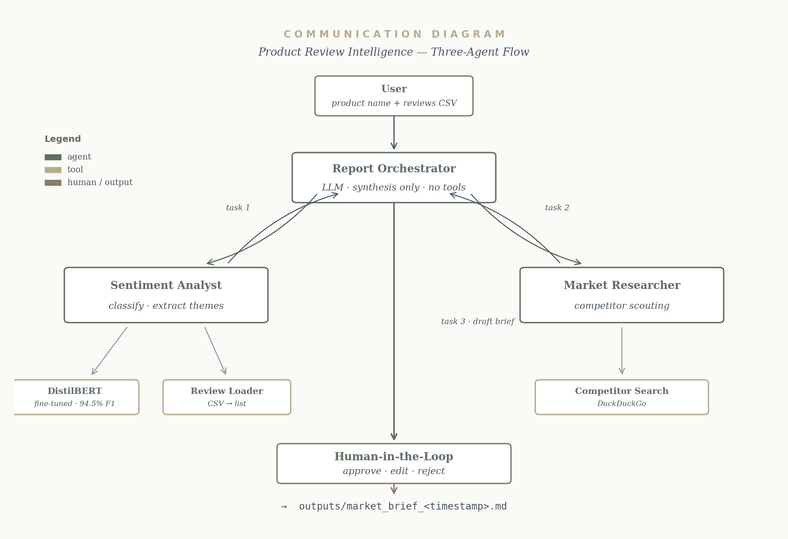
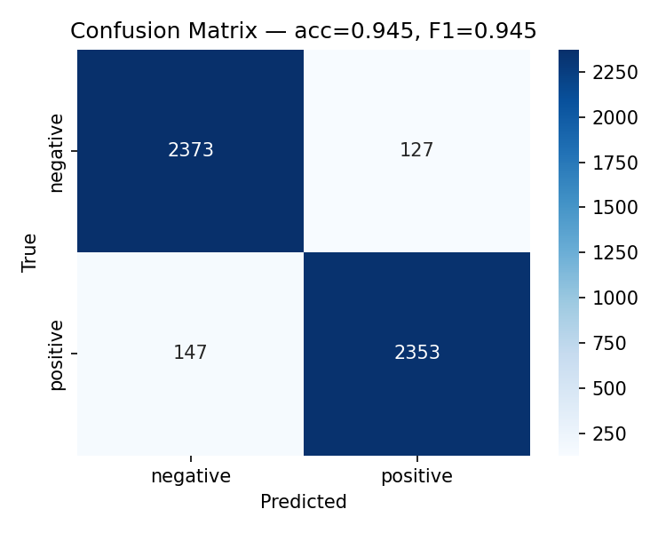

<div align="center">

# Product Review Intelligence
### Multi-Agent AI for Sentiment Analysis & Market Research

**Turning customer feedback into actionable business intelligence using Deep Learning, LLMs and autonomous AI agents.**


**Academic AI Project | Université Internationale de Rabat | 2025–2026**

</div>

---

## Project Overview

**Product Review Intelligence** is an end-to-end AI system designed to transform customer reviews into meaningful product insights, competitor intelligence and business recommendations.

The platform combines a fine-tuned **DistilBERT sentiment classifier** with a **three-agent AI architecture powered by CrewAI**.

The agents collaborate to analyze reviews, research competitors and generate a concise market intelligence report.

A **Human-in-the-Loop (HITL)** checkpoint allows users to review, edit, approve or reject the generated report before publication.

### Business Problem

Companies receive large volumes of customer feedback, making manual analysis time-consuming and difficult to scale.

This project investigates how Deep Learning and multi-agent systems can help automate sentiment classification, identify recurring customer concerns and support evidence-based business decisions.

---

## Key Features

- **Sentiment classification:** Fine-tuned DistilBERT predicts positive and negative review sentiment.
- **Customer insight extraction:** Identifies recurring complaints and positive feedback.
- **Competitor research:** Searches for relevant competing products and supporting web sources.
- **Automated reporting:** Generates a structured, one-page market intelligence brief.
- **Human validation:** Users can approve, edit or request revisions before accepting the output.
- **Interactive application:** Streamlit interface for uploading reviews and exploring results.
- **Traceable execution:** Structured JSONL logs capture agent activities.
- **Evaluation and testing:** Classification metrics, confusion matrix and automated tests.

---

## Multi-Agent Architecture

The system follows a sequential workflow involving three specialized agents.

| Agent | Responsibility | Main Tools |
|---|---|---|
| Sentiment Analyst | Classifies reviews and extracts customer feedback patterns | DistilBERT, Review Loader |
| Market Researcher | Investigates competing products using the identified concerns | Web Search |
| Report Orchestrator | Synthesizes insights and produces a market brief | LLM |

### Workflow

```text
             CUSTOMER PRODUCT REVIEWS
                        |
                        v
              +-------------------+
              |  Review Loader    |
              |      CSV          |
              +---------+---------+
                        |
                        v
              +-------------------+
              | SENTIMENT ANALYST |
              | Fine-tuned BERT   |
              +---------+---------+
                        |
               Sentiment & Insights
                        |
                        v
              +-------------------+
              | MARKET RESEARCHER |
              | Competitor Search |
              +---------+---------+
                        |
                Market Evidence
                        |
                        v
              +-------------------+
              | REPORT ORCHESTRATOR|
              | LLM Synthesis     |
              +---------+---------+
                        |
                        v
              +-------------------+
              | HUMAN-IN-THE-LOOP |
              | Approve / Revise  |
              +---------+---------+
                        |
                        v
                FINAL MARKET BRIEF
```

For additional technical details, see [Architecture Documentation](docs/architecture.md).



---

## Model Performance

The sentiment analysis component uses a fine-tuned **DistilBERT** classifier evaluated on a held-out subset of the Amazon Polarity dataset.

| Evaluation Metric | Result |
|---|---:|
| Accuracy | **94.52%** |
| Weighted F1-score | **94.52%** |
| Evaluation Reviews | **5,000** |
| Classification Classes | Positive / Negative |

### Confusion Matrix



These results reflect the saved sentiment classifier evaluation. They do not measure the correctness of competitor research or the quality of generated market reports.

Additional evaluation files:

- [Classification Report](outputs/eval_classification_report.txt)
- [Evaluation Metrics](outputs/eval_metrics.json)

---

## Technology Stack

| Category | Technologies |
|---|---|
| Programming | Python |
| Deep Learning | PyTorch, Hugging Face Transformers |
| Sentiment Model | DistilBERT |
| Multi-Agent Framework | CrewAI |
| Language Models | Google Gemini, optional Ollama |
| Dataset | Amazon Polarity |
| Web Research | DuckDuckGo Search |
| User Interface | Streamlit |
| Data Processing | Pandas, NumPy |
| Evaluation | Scikit-learn |
| Visualization | Matplotlib |
| Testing | Pytest |
| Logging | JSONL, Python Logging |

---

## Project Structure

```text
product-review-intelligence/
|
|-- src/
|   |-- agents/
|   |   |-- sentiment_analyst.py
|   |   |-- market_researcher.py
|   |   |-- orchestrator.py
|   |   `-- llm.py
|   |
|   |-- model/
|   |   |-- train.py
|   |   |-- evaluate.py
|   |   |-- inference.py
|   |   `-- dataset.py
|   |
|   |-- tools/
|   |   |-- review_loader_tool.py
|   |   |-- sentiment_tool.py
|   |   `-- competitor_search_tool.py
|   |
|   |-- utils/
|   |-- config.py
|   |-- crew.py
|   `-- main.py
|
|-- notebooks/
|   `-- demo.ipynb
|
|-- scripts/
|   `-- make_sample_reviews.py
|
|-- docs/
|   |-- architecture.md
|   `-- dataset_choice.md
|
|-- outputs/
|   |-- communication_diagram.png
|   |-- eval_confusion_matrix.png
|   `-- eval_metrics.json
|
|-- deliverables/
|   |-- REPORT.pdf
|   `-- PRESENTATION.pptx
|
|-- tests/
|-- .env.example
|-- .gitignore
|-- requirements.txt
|-- streamlit_app.py
`-- README.md
```

---

## Installation & Setup

### Prerequisites

- Python 3.10+
- Git
- pip
- Internet access for external LLM and competitor-search services
- Gemini API key, or a configured local Ollama instance

### 1. Clone the repository

```bash
git clone https://github.com/Rania-Bouaroua/Product-Review-Intelligence-MultiAgent-AI.git
cd Product-Review-Intelligence-MultiAgent-AI
```

### 2. Create a virtual environment

Windows PowerShell:

```powershell
python -m venv .venv
.\.venv\Scripts\Activate.ps1
```

### 3. Install dependencies

```powershell
python -m pip install -r requirements.txt
```

### 4. Configure environment variables

Create a local `.env` file from `.env.example`:

```powershell
Copy-Item .env.example .env
```

Configure the required values:

```dotenv
GEMINI_API_KEY=your_api_key_here
MODEL=gemini/gemini-2.0-flash

MODEL_DIR=models/sentiment_bert
LOG_DIR=logs
OUTPUT_DIR=outputs
```

The configured model must be available through the selected LLM provider.

**Never commit API keys or personal credentials.**

### 5. Train the sentiment classifier

For the default training configuration:

```powershell
python -m src.model.train
```

For a shorter experimental run:

```powershell
python -m src.model.train --epochs 1 --subset 5000
```

### 6. Evaluate the model

```powershell
python -m src.model.evaluate
```

Evaluation artifacts are saved in `outputs/`.

### 7. Generate demonstration reviews

```powershell
python scripts/make_sample_reviews.py
```

### 8. Run the Streamlit application

```powershell
streamlit run streamlit_app.py
```

Then open:

http://localhost:8501

### Alternative: Command-Line Interface

```powershell
python -m src.main --product "Wireless Earbuds X" --reviews data/processed/sample_reviews.csv
```

The agent workflow generates a market brief using the supplied product reviews and configured LLM.

---

## Testing & Reproducibility

The project includes automated tests covering data loading, sentiment analysis tools, logging and edge cases.

Run the tests using:

```powershell
python -m pytest -q
```

Reproducibility features include:

- Centralized configuration in `src/config.py`
- Random seed configuration
- Structured agent execution logs
- Saved evaluation metrics
- Reusable data preparation scripts
- Documented model training parameters

---

## Documentation & Deliverables

| Resource | Link |
|---|---|
| Technical Architecture | [architecture.md](docs/architecture.md) |
| Dataset Selection | [dataset_choice.md](docs/dataset_choice.md) |
| Project Report | [REPORT.pdf](deliverables/REPORT.pdf) |
| Presentation | [PRESENTATION.pptx](deliverables/PRESENTATION.pptx) |
| Demo Notebook | [demo.ipynb](notebooks/demo.ipynb) |
| Demo Video | [Watch Demo](https://youtu.be/3ngsXPVdwVw) |

---

## Limitations

- Sentiment prediction accuracy does not guarantee correct business recommendations.
- Competitor research depends on external search results and their availability.
- LLM-generated summaries require human verification.
- The initial sentiment classifier supports binary sentiment categories.
- Domain-specific product reviews may differ from the model's training distribution.
- Cloud-based LLM execution depends on API availability and usage limits.

---

## Future Improvements

- Multi-class and aspect-based sentiment analysis
- Multilingual review support
- Additional benchmark datasets
- Recommendation quality evaluation
- Enhanced competitor comparison dashboards
- Improved automated factual verification
- CI/CD and containerized deployment
- More extensive end-to-end testing

---

## Academic Context

Developed at the **Université Internationale de Rabat (UIR)** as an integrated Big Data & Artificial Intelligence project.

**Academic Year:** 2025–2026

**Team Members:**
- Chaymae Benmakhlouf
- Maroua Ait Sassi
- Rania Bouaroua

**Supervisor:** Prof. Hakim Hafidi

This project demonstrates practical experience in Deep Learning, multi-agent orchestration, LLM integration, software engineering and business intelligence.

---

<div align="center">

**Built with Python, Deep Learning and Multi-Agent AI.**

*From customer reviews to actionable market intelligence.*

</div>
